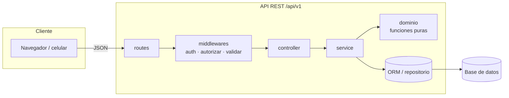

# ARCHITECTURE.md — <Nombre del proyecto>

> Plantilla del arnés. Reemplaza lo que está entre `< >`. Mantén el diagrama al día: si cambias una capa, cambia este archivo en el mismo PR.

## 1. Vista general



**Regla de dependencias** (la hace cumplir `.dependency-cruiser.cjs`): cada capa solo depende de la de su derecha. `dominio/` no depende de nada del framework ni de la BD.

## 2. Estructura de carpetas

```
<raíz>/
├── AGENTS.md  CLAUDE.md  ARCHITECTURE.md  README.md
├── docs/  requerimientos.md  PROYECTO.md  bitacora-ia.md  adr/
├── src/
│   ├── app.ts  server.ts
│   ├── config/        variables de entorno, permisos
│   ├── middlewares/   auth, autorizar, validar, errores
│   ├── lib/           cliente del ORM, paginación, utilidades sin dominio
│   └── modules/<modulo>/
│       ├── <modulo>.routes.ts
│       ├── <modulo>.controller.ts
│       ├── <modulo>.service.ts
│       ├── <modulo>.schemas.ts
│       ├── dominio/   reglas puras (cálculos, validaciones de negocio)
│       └── <modulo>.test.ts
└── prisma/  schema.prisma  migrations/  seed.ts
```

## 3. Módulos

| Módulo | Responsable | Requerimientos | Depende de |
|---|---|---|---|
| <modulo> | <integrante> | RF-xx–RF-yy | <otro módulo vía su service> |

## 4. Decisiones

Ver `docs/adr/`. Cada decisión que cambie esta arquitectura necesita un ADR nuevo.
