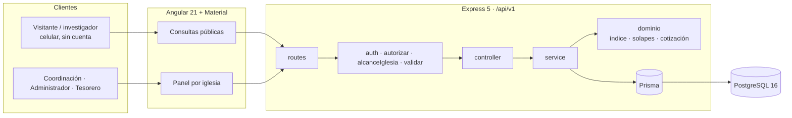

# ARCHITECTURE.md — Ecclesia

> Hecho con la plantilla `arnes-ia/core/arquitectura/ARCHITECTURE.plantilla.md`. Decisiones en [`adr/`](adr/).

## 1. Vista general



- **Público** (`/api/v1/public/...`): solo lectura, sin sesión; nunca devuelve datos privados (RNF-01, RNF-08).
- **Panel**: JWT; cada ruta de una iglesia pasa por `alcanceIglesia`, que compara la iglesia del usuario con la del recurso **leída de la BD** (RNF-10).
- **Dominio puro**: índice patrimonial, solape de misas de un padre, vigencia de cotizaciones. Reciben el «ahora» y la zona horaria como parámetros.

## 2. Estructura

```
backend/src/
├── config/        env, permisos (Coordinación, Administrador, Tesorero)
├── middlewares/   autenticar, autorizar, alcanceIglesia, validar, errores
├── lib/           prisma, paginación, zona horaria
└── modules/
    ├── catalogos/     INEGI: estados, municipios, localidades
    ├── iglesias/      + dominio/indice-patrimonial.ts
    ├── patrimonio/    objetos
    ├── servicios/     servicios y pláticas
    ├── misas/         horarios, misas celebradas, padres + dominio/solapes.ts
    ├── diezmo/        captura, correcciones auditadas, reportes
    ├── espacios/      tipos, solicitudes (folio + clave), cotizaciones
    ├── usuarios/      y auth
    └── public/        consultas sin sesión
```

## 3. Módulos y dueños

| Módulo | Responsable | Requerimientos |
|---|---|---|
| catalogos, iglesias, patrimonio, ranking | Nataly | RF-01–29, RN-01–19 |
| servicios, misas, padres | Genaro | RF-30–59, RN-20–39 |
| diezmo, espacios, usuarios | Oscar | RF-60–89, RN-40–59 |
| infraestructura, auth, alcance, arnés | Santiago | RNF-01–20 |

## 4. Reglas que verifica el arnés

`arnes-ia/stacks/express/.dependency-cruiser.cjs`: sin ciclos · controllers sin Prisma · `dominio/` puro · módulos solo por su service · producción sin importar pruebas.
