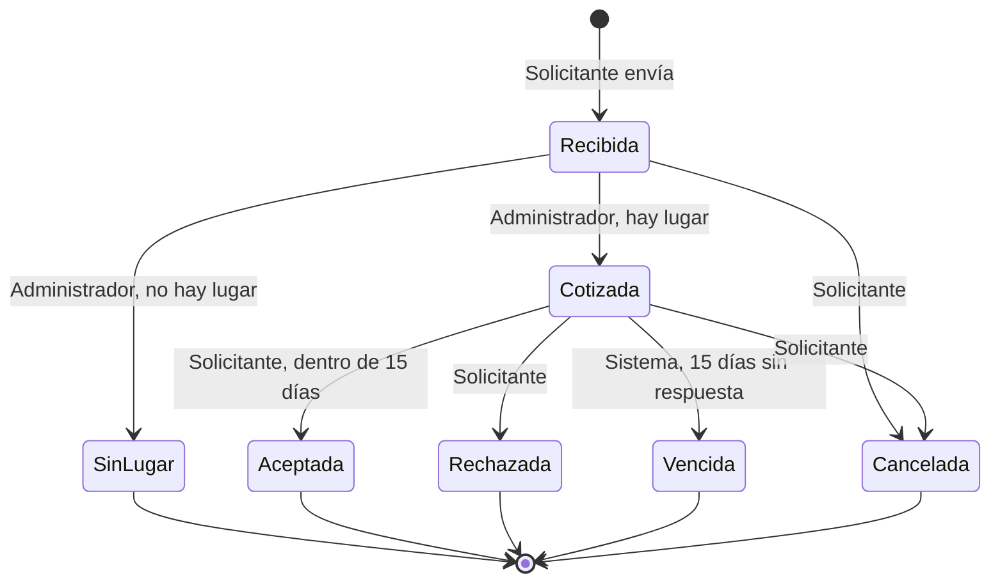

# Requerimientos — Proyecto Ecclesia (Sistema Nacional de Gestión de Iglesias)

> **Cliente:** Coordinación Nacional de Templos (caso del 30 de octubre de 2026). **Fase 1:** análisis del caso y arnés.
> **Equipo:** Santiago Asahel Pech Ake · Nataly Marisol Santos Miam · Genaro Aurelio Antonio Pacheco · Oscar Michel Matos May (líder).
> **Caso del cliente (fuente de todas las citas):** [Proyecto_Ecclesia_Sistema_Nacional_de_Gestion_de_Iglesias.docx](ecclesia/Proyecto_Ecclesia_Sistema_Nacional_de_Gestion_de_Iglesias.docx).
> **Herramienta de IA:** Claude Code (una sola en todo el proyecto). Arnés: carpeta [`arnes-ia/`](../arnes-ia/README.md).

## Cómo se llena este documento (léelo antes de escribir)

1. Cada integrante escribe **solo su sección** (ver tabla) y usa **solo su rango de IDs**, así nada choca al juntar.
2. Todo requerimiento lleva **origen**: una cita textual del caso entre «comillas» y el apartado de donde sale. **Sin origen, se descarta.**
3. Redacción **verificable**: quién hace qué y qué se ve. ✅ «El visitante elige un estado y ve la lista de sus iglesias activas». ❌ «El sistema debe ser fácil».
4. **Prioridad**: `Obligatorio` o `Deseable` (deseable = lo que el cliente pide «si alcanza el tiempo»).
5. Lo ambiguo **no se inventa**: va como pregunta en la sección 8 con tu rango `P-`.
6. Al terminar, marca en la lista de «párrafos a cubrir» de tu sección cuáles quedaron cubiertos y con qué IDs.

| Integrante | Apartados del caso | RF | RN | CA | P |
|---|---|---|---|---|---|
| Nataly | Las iglesias · El patrimonio · Las iglesias más reconocidas | RF-01–29 | RN-01–19 | CA-01–09 | P-01–09 |
| Genaro | Los servicios y las pláticas · Las misas y los padres | RF-30–59 | RN-20–39 | CA-10–19 | P-10–19 |
| Oscar | El diezmo · Las criptas y otros espacios · Quién usará el sistema · Si alcanza el tiempo | RF-60–89 | RN-40–59 | CA-20–29 | P-20–29 |
| Santiago | Quiénes somos y qué nos pasa · requerimientos no funcionales · integración | — | — | — | P-30–39 (RNF-01–20) |

---

## 1. Actores y sus objetivos

| Actor | Quién es | Qué quiere lograr | Origen |
|---|---|---|---|
| Visitante | Cualquier persona, sin cuenta, casi siempre desde el celular | Consultar iglesias, servicios, pláticas, misas e iglesias reconocidas | «Cualquier persona podrá consultar iglesias, servicios, pláticas, misas e iglesias reconocidas sin crear una cuenta, casi siempre desde el celular» (Quién usará el sistema) |
| Investigador | Visitante que busca por patrimonio | Buscar iglesias por tipo de objeto y antigüedad en un estado, municipio o ciudad | «Los investigadores también nos piden búsquedas como "todas las iglesias de Puebla con imágenes de 300 años o más"» (Las iglesias más reconocidas) |
| Solicitante de espacio | Visitante que pide una cripta, nicho, columbario u osario | Pedir un espacio sin crear cuenta, dar seguimiento con folio y clave, aceptar o rechazar la cotización | «Quien necesita un espacio llena una solicitud con sus datos de contacto, sin crear una cuenta, y recibe un folio y una clave» (Las criptas y otros espacios) |
| Personal de la Coordinación | Usuario de la Coordinación Nacional de Templos | Administrar catálogos, iglesias, usuarios y los criterios del índice; y, si alcanza el tiempo, comparar el diezmo entre iglesias | «El personal de la Coordinación administrará los catálogos, las iglesias, los usuarios y los criterios del índice» (Quién usará el sistema) · «comparar el diezmo entre las iglesias de un municipio o estado, solo para la Coordinación» (Si alcanza el tiempo) |
| Administrador de iglesia | Usuario asignado a una iglesia | Llevar datos, objetos, servicios, pláticas, padres, horarios, misas y solicitudes de **su** iglesia | «En cada iglesia habrá un administrador que lleve sus datos, objetos, servicios, pláticas, padres, horarios, misas y solicitudes» (Quién usará el sistema) |
| Tesorero de iglesia | Usuario asignado a una iglesia | Capturar y corregir el diezmo de cada misa de **su** iglesia. *(Quién ve los reportes: P-21)* | «un tesorero que capture el diezmo» (Quién usará el sistema) · «Queremos que el tesorero de cada iglesia capture lo que se juntó en cada misa ya celebrada» (El diezmo) |
| Padre (oficiante) | Sacerdote que oficia las misas; puede celebrar en varias iglesias. En el caso aparece como dato que lleva el administrador, no como usuario con cuenta *(P-18, P-19)* | Que se sepa qué misas oficia y que no se le programe en dos a la misma hora | «En cada misa, la gente quiere saber qué padre la va a oficiar» (Las misas y los padres) · «queremos ver la agenda semanal de cada padre» (Las misas y los padres) |

> Revisada al cubrir «Quién usará el sistema». El caso solo menciona estos dos usuarios por iglesia (administrador y tesorero) y el personal de la Coordinación; no menciona otros roles de iglesia (P-20, P-28).

---

## 2. Requerimientos funcionales

Formato de cada fila: `| ID | Requerimiento | Prioridad | Origen |`

### 2.1 Iglesias, patrimonio e iglesias reconocidas — **Nataly** (RF-01–29)

Párrafos a cubrir:
- [x] «la persona elige su estado y quiere ver todas las iglesias que hay en él» (Las iglesias) → RF-01, CA-02
- [x] «puede acotar por municipio, ciudad, tipo, nombre o capacidad» (Las iglesias) → RF-02–RF-05, CA-03, P-02, P-03
- [x] «al elegir una iglesia espera encontrar en un solo lugar todo lo que sabemos de ella» (Las iglesias) → RF-06, RF-16, CA-04
- [x] Datos de la iglesia: nombre, tipo, dirección, localidad, municipio, estado (catálogo INEGI), capacidad, año, contacto, coordenadas (Las iglesias) → RF-07–RF-10, RN-08, RN-09, CA-09
- [x] Iglesia cerrada: conserva su historia pero no aparece en consultas (Las iglesias) → RF-11, RF-12, RN-07, P-04
- [x] Objetos: qué es, tipo, año o siglo, material, estado de conservación, ubicación en el templo, catalogado por INAH (El patrimonio) → RF-13, RF-14, RF-17, RN-10, RN-16, P-05, P-06
- [x] Objeto perdido, prestado o dado de baja: deja de contar, no se borra (El patrimonio) → RF-15, RN-11, CA-05, P-08
- [x] Índice de valor patrimonial y distinción junto a cada iglesia (Las iglesias más reconocidas) → RF-18, RN-01–RN-06, RN-15, CA-01, P-01
- [x] Ranking nacional, por estado, municipio y ciudad, sin cerradas ni iglesias sin objetos (Las iglesias más reconocidas) → RF-19–RF-21, RN-12, RN-13, CA-06, P-07
- [x] Criterios del índice ajustables sin reprogramar (Las iglesias más reconocidas) → RF-22, RN-14, CA-07
- [x] Búsqueda por tipo de objeto y antigüedad en un estado, municipio o ciudad (Las iglesias más reconocidas) → RF-23, CA-08, P-09

| ID | Requerimiento | Prioridad | Origen |
|---|---|---|---|
| RF-01 | El visitante elige un estado y ve la lista de sus iglesias activas. | Obligatorio | «la persona elige su estado y quiere ver todas las iglesias que hay en él» (Las iglesias) |
| RF-02 | El visitante acota la lista del estado por municipio y por ciudad o localidad. | Obligatorio | «Después puede acotar por municipio, ciudad, tipo, nombre o capacidad» (Las iglesias) |
| RF-03 | El visitante acota la lista por tipo de iglesia (catedral, basílica, parroquia, templo, capilla o santuario). | Obligatorio | «puede acotar por municipio, ciudad, tipo, nombre o capacidad» · «si es catedral, basílica, parroquia, templo, capilla o santuario» (Las iglesias) |
| RF-04 | El visitante busca iglesias por su nombre dentro de la lista. *(Forma de coincidencia: P-02)* | Obligatorio | «puede acotar por municipio, ciudad, tipo, nombre o capacidad» (Las iglesias) |
| RF-05 | El visitante acota la lista por capacidad (cuántas personas caben). *(Mínimo o rango: P-03)* | Obligatorio | «puede acotar por municipio, ciudad, tipo, nombre o capacidad» · «cuántas personas caben» (Las iglesias) |
| RF-06 | Al elegir una iglesia, el visitante ve su ficha en una sola pantalla: sus datos, sus objetos vigentes, su índice y distinción, y lo que registran los otros módulos de esa iglesia (servicios, pláticas, misas con su padre y tipos de espacio). | Obligatorio | «al elegir una iglesia espera encontrar en un solo lugar todo lo que sabemos de ella» (Las iglesias) |
| RF-07 | El personal de la Coordinación registra una iglesia con nombre, tipo, dirección, ciudad o localidad, municipio, estado, capacidad, año de construcción, contacto y, si las tiene, coordenadas. | Obligatorio | «De cada iglesia necesitamos su nombre, si es catedral, basílica, parroquia, templo, capilla o santuario, y dónde está: dirección, ciudad o localidad, municipio y estado» · «cuántas personas caben, en qué año se construyó, cómo contactarla y, cuando las tenemos, sus coordenadas» (Las iglesias) · «El personal de la Coordinación administrará los catálogos, las iglesias» (Quién usará el sistema) |
| RF-08 | El personal de la Coordinación y el administrador de esa iglesia modifican sus datos; el administrador solo los de su iglesia. | Obligatorio | «En cada iglesia habrá un administrador que lleve sus datos» · «Nadie de una iglesia debe poder modificar la información de otra» (Quién usará el sistema) |
| RF-09 | Al registrar o editar una iglesia, el usuario elige el estado, después un municipio de ese estado y después una localidad de ese municipio, siempre del catálogo del INEGI. | Obligatorio | «Los estados, municipios y localidades deben coincidir con el catálogo oficial del INEGI» (Las iglesias) |
| RF-10 | El personal de la Coordinación carga y actualiza el catálogo de estados, municipios y localidades a partir del catálogo oficial del INEGI. | Obligatorio | «deben coincidir con el catálogo oficial del INEGI» (Las iglesias) · «El personal de la Coordinación administrará los catálogos» (Quién usará el sistema) |
| RF-11 | El personal marca una iglesia como cerrada con la fecha y el motivo (por ejemplo, daños o desuso); desde ese momento no aparece en las consultas públicas, la búsqueda ni el ranking. *(Quién puede cerrarla y si se reabre: P-04)* | Obligatorio | «A veces una iglesia cierra, ya sea por daños, como les pasó a muchas con los sismos de 2017, o porque deja de usarse» · «tampoco que siga apareciendo en las consultas» (Las iglesias) |
| RF-12 | El personal de la Coordinación consulta las iglesias cerradas con sus datos, sus objetos, la fecha y el motivo del cierre. | Obligatorio | «No queremos perder su historia» (Las iglesias) |
| RF-13 | El administrador de la iglesia registra un objeto con qué es, tipo, año o siglo, material, estado de conservación, ubicación en el templo y si está catalogado por el INAH. | Obligatorio | «De cada objeto queremos saber qué es, de qué tipo, de qué año, de qué material, en qué estado se conserva y en qué parte del templo está» · «Algunas están catalogadas como patrimonio por el INAH» (El patrimonio) |
| RF-14 | El administrador modifica los datos de los objetos de su iglesia. | Obligatorio | «En cada iglesia habrá un administrador que lleve sus datos, objetos» (Quién usará el sistema) |
| RF-15 | El administrador marca un objeto como perdido, prestado o dado de baja, con fecha y motivo; el objeto deja de contar en el índice y su registro se conserva. *(Regreso de un préstamo: P-08)* | Obligatorio | «Si un objeto se pierde, se presta o se da de baja, deja de contar, pero su registro no se borra» (El patrimonio) |
| RF-16 | En la ficha de la iglesia, el visitante ve la lista de sus objetos vigentes con qué es, tipo, año o siglo, material y si está catalogado por el INAH. *(Qué datos son públicos: P-05)* | Obligatorio | «al elegir una iglesia espera encontrar en un solo lugar todo lo que sabemos de ella» (Las iglesias) · «Muchas iglesias resguardan objetos de gran valor» (El patrimonio) |
| RF-17 | Si no se conoce el año exacto de un objeto, el administrador captura solo el siglo y el sistema lo muestra como siglo (por ejemplo, «siglo XVIII»). | Obligatorio | «De muchas piezas no conocemos el año exacto, solo el siglo» (El patrimonio) |
| RF-18 | El sistema calcula el índice de valor patrimonial de cada iglesia con los criterios vigentes y muestra la distinción junto a la iglesia en las listas, la ficha y el ranking. | Obligatorio | «Queremos que el sistema lo calcule» · «queremos que la distinción aparezca junto a cada iglesia» (Las iglesias más reconocidas) |
| RF-19 | El visitante ve las iglesias más reconocidas del país, ordenadas de mayor a menor índice, con su índice y distinción. | Obligatorio | «que la gente vea las iglesias más reconocidas del país» · «En la lista, las iglesias van de mayor a menor índice» (Las iglesias más reconocidas) |
| RF-20 | El visitante ve las iglesias más reconocidas de un estado, de un municipio o de una ciudad que elige. | Obligatorio | «las iglesias más reconocidas del país, de un estado, de un municipio o de una ciudad» (Las iglesias más reconocidas) |
| RF-21 | El ranking no muestra iglesias cerradas ni iglesias sin objetos registrados. *(Iglesias con objetos pero ninguno vigente: P-07)* | Obligatorio | «no aparecen las que están cerradas ni las que no tienen objetos registrados» (Las iglesias más reconocidas) |
| RF-22 | El personal de la Coordinación consulta y modifica los criterios del índice (rangos de antigüedad y sus puntos, multiplicadores por tipo, puntos del INAH y umbrales y nombres de las distinciones); el índice de todas las iglesias se calcula con los nuevos criterios desde que se guardan, sin cambiar código. | Obligatorio | «Revisamos estos criterios cada año, así que queremos ajustarlos sin tener que reprogramar el sistema» (Las iglesias más reconocidas) · «El personal de la Coordinación administrará […] los criterios del índice» (Quién usará el sistema) |
| RF-23 | El investigador elige un tipo de objeto, una antigüedad mínima en años y un estado, municipio o ciudad, y ve las iglesias activas que tienen al menos un objeto vigente que cumple. *(Detalles: P-09)* | Obligatorio | «"todas las iglesias de Puebla con imágenes de 300 años o más"» · «Queremos buscar así, por tipo de objeto y antigüedad, en un estado, un municipio o una ciudad» (Las iglesias más reconocidas) |

### 2.2 Servicios, pláticas, misas y padres — **Genaro** (RF-30–59)

Párrafos a cubrir:
- [x] Servicios de cada iglesia (bautizo, primera comunión, confirmación, casamiento y otros): costo o gratuito/donativo, requisitos, duración, si requiere cita, días y horarios (Los servicios y las pláticas) → RF-30–RF-35, RN-22, RN-23, CA-10, P-10–P-12
- [x] Pláticas de preparación: días, hora, número de sesiones, costo, cupo, lugar y quién la imparte (Los servicios y las pláticas) → RF-36–RF-38, RN-24, RN-25, CA-11, P-13, P-14
- [x] «¿cuándo son las pláticas de bautizo?» como consulta frecuente (Los servicios y las pláticas) → RF-39, CA-11
- [x] Horario semanal de misas: días, hora, tipo (diaria, dominical, especial) e idioma (Las misas y los padres) → RF-42, RF-44, RN-20, RN-21, CA-12, P-16, P-19
- [x] Padre que oficia cada misa (Las misas y los padres) → RF-40, RF-43, RF-44, CA-12, P-19
- [x] Un padre en varias iglesias; sin dos misas a la misma hora en templos distintos; una hora por misa salvo otra duración (Las misas y los padres) → RF-41, RF-45, RF-46, RN-26–RN-28, CA-13, CA-14, P-15
- [x] Agenda semanal de cada padre (Las misas y los padres) → RF-47, CA-17, P-18
- [x] Misa celebrada como hecho: quién la dio realmente, quién hizo el cambio y por qué (Las misas y los padres) → RF-48–RF-51, RN-29, RN-30, CA-15, P-17
- [x] Hora local de cada iglesia (varias zonas horarias) (Las misas y los padres) → RF-52, RN-31, CA-16, P-15

| ID | Requerimiento | Prioridad | Origen |
|---|---|---|---|
| RF-30 | El administrador de una iglesia registra un servicio de su iglesia con su nombre: bautizo, primera comunión, confirmación, casamiento u otro. *(Lista de "otros": P-10)* | Obligatorio | «Cada iglesia ofrece servicios como bautizos, primeras comuniones, confirmaciones y casamientos, y a veces otros, como misas de XV años o bendiciones» (Los servicios y las pláticas) · «un administrador que lleve sus datos, objetos, servicios, pláticas, padres, horarios, misas y solicitudes» (Quién usará el sistema) |
| RF-31 | El administrador captura el costo de cada servicio, o lo marca como gratuito o como cubierto con un donativo voluntario. *(Forma del costo: P-11)* | Obligatorio | «Los costos los fija cada iglesia, y algunos servicios son gratuitos o se cubren con un donativo voluntario» (Los servicios y las pláticas) |
| RF-32 | El administrador captura de cada servicio sus requisitos, cuánto dura y si requiere cita. | Obligatorio | «De cada servicio importan los requisitos, cuánto dura, si requiere cita y los días y horarios en que se celebra» (Los servicios y las pláticas) |
| RF-33 | El administrador captura los días y horarios en que se celebra cada servicio. *(Días fijos o por cita: P-12)* | Obligatorio | «los días y horarios en que se celebra» (Los servicios y las pláticas) |
| RF-34 | El administrador modifica los servicios de su iglesia. | Obligatorio | «un administrador que lleve sus datos, objetos, servicios, pláticas, padres, horarios, misas y solicitudes» (Quién usará el sistema) |
| RF-35 | El visitante ve, en la ficha de una iglesia, sus servicios con nombre, costo (o gratuito o donativo), requisitos, duración, si requiere cita, días y horarios. | Obligatorio | «Cualquier persona podrá consultar iglesias, servicios, pláticas, misas e iglesias reconocidas sin crear una cuenta» (Quién usará el sistema) · «cuánto cuesta un bautizo» (Quiénes somos y qué nos pasa) |
| RF-36 | El administrador registra una plática de su iglesia con su tipo (prebautismal, catecismo de primera comunión, de confirmación o prematrimonial), qué días y a qué hora se imparte, cuántas sesiones tiene, cuánto cuesta, cuántas personas caben, dónde es y quién la da. *(Cupo: P-13; quién la da: P-14)* | Obligatorio | «De cada una queremos saber qué días y a qué hora se imparte, cuántas sesiones tiene, cuánto cuesta, cuántas personas caben, dónde es y quién la da» · «pláticas prebautismales para papás y padrinos, catecismo para la primera comunión, pláticas de confirmación y pláticas prematrimoniales» (Los servicios y las pláticas) |
| RF-37 | El administrador modifica las pláticas de su iglesia. | Obligatorio | «un administrador que lleve sus datos, objetos, servicios, pláticas, padres, horarios, misas y solicitudes» (Quién usará el sistema) |
| RF-38 | El visitante ve, en la ficha de una iglesia, sus pláticas con todos los datos de RF-36. | Obligatorio | «Cualquier persona podrá consultar iglesias, servicios, pláticas, misas e iglesias reconocidas sin crear una cuenta» (Quién usará el sistema) · «De cada una queremos saber qué días y a qué hora se imparte» (Los servicios y las pláticas) |
| RF-39 | El visitante elige un tipo de plática (por ejemplo, de bautizo) y ve, de la iglesia que consulta, qué días y a qué hora se imparte. | Obligatorio | «Una pregunta muy frecuente es» · «¿cuándo son las pláticas de bautizo?» (Los servicios y las pláticas) |
| RF-40 | El administrador registra los padres de su iglesia. *(Datos del padre: P-19)* | Obligatorio | «un administrador que lleve sus datos, objetos, servicios, pláticas, padres, horarios, misas y solicitudes» (Quién usará el sistema) |
| RF-41 | Un mismo padre se asocia a más de una iglesia (el párroco y sus vicarios atienden las capillas de su parroquia, y un padre puede suplir en otra). *(Quién lo asocia: P-19)* | Obligatorio | «Un padre suele celebrar en varias iglesias: el párroco y sus vicarios atienden también las capillas de su parroquia, y a veces un padre suple en otra» (Las misas y los padres) |
| RF-42 | El administrador registra el horario semanal de misas de su iglesia: qué días, a qué hora, tipo (diaria, dominical o especial) e idioma. *(Misa especial: P-16)* | Obligatorio | «Cada iglesia tiene un horario semanal: qué días, a qué hora, si la misa es diaria, dominical o especial, y en qué idioma» (Las misas y los padres) |
| RF-43 | El administrador asigna a cada misa del horario el padre que la va a oficiar. | Obligatorio | «En cada misa, la gente quiere saber qué padre la va a oficiar» (Las misas y los padres) |
| RF-44 | El visitante ve el horario semanal de misas de una iglesia con día, hora, tipo, idioma y el padre que oficia cada misa. | Obligatorio | «Lo más consultado son los horarios de misa» · «En cada misa, la gente quiere saber qué padre la va a oficiar» (Las misas y los padres) |
| RF-45 | Al programar o cambiar una misa, el sistema rechaza asignar a un padre que ya tiene otra misa a la misma hora, aunque sea en otra iglesia, y le indica al administrador con cuál choca. *(Qué cuenta como «misma hora»: P-15)* | Obligatorio | «Ya nos pasó que programaron a un padre en dos misas a la misma hora en templos distintos, y eso no debe volver a ocurrir» (Las misas y los padres) |
| RF-46 | Cada misa dura una hora; el administrador puede indicar otra duración para una misa. | Obligatorio | «Contamos una hora por misa, salvo que se indique otra duración» (Las misas y los padres) |
| RF-47 | El personal de la Coordinación y el de la iglesia consultan la agenda semanal de un padre: todas sus misas de la semana, de todas las iglesias donde celebra, con la iglesia, el día y la hora de cada una. *(Si también la ve el público: P-18)* | Obligatorio | «queremos ver la agenda semanal de cada padre» (Las misas y los padres) |
| RF-48 | El administrador registra una misa celebrada: el día, la hora y el padre que la ofició, a partir de una misa del horario. | Obligatorio | «cada misa celebrada es un hecho: un día, una hora y un padre que la ofició» (Las misas y los padres) |
| RF-49 | El administrador registra que una misa la ofició un padre distinto del programado (sustitución) e indica el motivo. *(Quién y cuándo puede hacerlo: P-17)* | Obligatorio | «A veces el titular se enferma y lo sustituye otro; queremos saber quién la dio realmente, quién hizo el cambio y por qué» (Las misas y los padres) |
| RF-50 | Cada sustitución guarda quién hizo el cambio, el padre programado, el padre que la dio realmente, el motivo y la fecha del cambio; ese registro no se edita. | Obligatorio | «queremos saber quién la dio realmente, quién hizo el cambio y por qué» (Las misas y los padres) |
| RF-51 | El personal de la Coordinación y el de la iglesia consultan, de cada misa celebrada, quién la dio realmente y, si hubo sustitución, quién hizo el cambio y por qué. | Obligatorio | «queremos saber quién la dio realmente, quién hizo el cambio y por qué» (Las misas y los padres) |
| RF-52 | El horario de misas y las misas celebradas se muestran en la hora local de la iglesia, sin convertirlas a la hora de quien consulta. *(Ver RNF-07)* | Obligatorio | «Como México tiene varias zonas horarias, la hora de cada misa es la hora local de su iglesia» (Las misas y los padres) |

### 2.3 Diezmo, espacios, usuarios y deseables — **Oscar** (RF-60–89)

Párrafos a cubrir:
- [x] El tesorero captura el diezmo de cada misa ya celebrada, una sola vez por misa (El diezmo) → RF-60, RF-61, RN-40, RN-41, CA-20, CA-21, P-22
- [x] Corrección con registro de quién, cuándo y cantidad anterior (El diezmo) → RF-62, RF-63, RN-42–RN-44, CA-22, P-22
- [x] Reportes: total del periodo, promedio por misa, misas con más y con menos; por día, semana, mes, horario y padre; solo personal de la iglesia (El diezmo) → RF-64–RF-69, RN-44–RN-46, CA-23–CA-25, P-21, P-23
- [x] Tipos de espacio visibles al público, sin precios (Las criptas y otros espacios) → RF-70, RF-71, RN-47, RN-48, CA-26, P-24
- [x] Solicitud sin cuenta con folio y clave; revisión del administrador; cotización o aviso de que no hay lugar (Las criptas y otros espacios) → RF-72–RF-77, RN-49, RN-50, CA-26–CA-28, P-25–P-27
- [x] Aceptar o rechazar; vigencia de 15 días; cancelar mientras no acepte; datos privados (Las criptas y otros espacios) → RF-78–RF-80, RN-51–RN-53, CA-28, CA-29, P-26, P-27
- [x] Roles y alcance por iglesia: nadie modifica la información de otra iglesia (Quién usará el sistema) → RF-81, RF-82, RF-87, RN-54, CA-25, P-20, P-28
- [x] Deseables: pláticas por municipio, misas semanales generadas desde el horario, comparar diezmo entre iglesias (solo Coordinación), inventario de criptas (Si alcanza el tiempo) → RF-83–RF-86, P-29

| ID | Requerimiento | Prioridad | Origen |
|---|---|---|---|
| RF-60 | El tesorero de una iglesia captura el monto que se juntó de diezmo en una misa ya celebrada de su iglesia. *(Qué es «ya celebrada»: P-22)* | Obligatorio | «Queremos que el tesorero de cada iglesia capture lo que se juntó en cada misa ya celebrada» (El diezmo) · «un tesorero que capture el diezmo» (Quién usará el sistema) |
| RF-61 | Cada misa celebrada admite una sola captura de diezmo: si ya tiene una, el sistema rechaza la segunda y le indica al tesorero que debe corregir la existente. | Obligatorio | «una sola vez por misa» (El diezmo) |
| RF-62 | El tesorero corrige el monto de una captura de diezmo de su iglesia. *(Plazo y quién corrige: P-22)* | Obligatorio | «Si se equivoca puede corregirlo» (El diezmo) |
| RF-63 | Cada corrección guarda quién la hizo, cuándo la hizo y qué cantidad había antes, y el tesorero y el administrador consultan ese historial en la captura. | Obligatorio | «debe quedar quién lo cambió, cuándo y qué cantidad había antes» (El diezmo) |
| RF-64 | El personal de la iglesia consulta cuánto se juntó de diezmo en un periodo que elige. | Obligatorio | «Con eso queremos saber cuánto se juntó en un periodo» (El diezmo) |
| RF-65 | El reporte muestra el promedio de diezmo por misa y cuáles son las misas con más y con menos diezmo del periodo. *(Cuántas se muestran y cómo se calcula el promedio: P-23)* | Obligatorio | «el promedio por misa y las misas con más y con menos» (El diezmo) |
| RF-66 | El personal de la iglesia ve el diezmo agrupado por día, por semana o por mes. *(Inicio de la semana: P-23)* | Obligatorio | «por día, semana o mes» (El diezmo) |
| RF-67 | El personal de la iglesia ve el diezmo agrupado por horario de misa. | Obligatorio | «por horario de misa» (El diezmo) |
| RF-68 | El personal de la iglesia ve el diezmo agrupado por padre. *(Padre programado o que la dio realmente: P-23)* | Obligatorio | «y por padre» (El diezmo) |
| RF-69 | Los reportes de diezmo y las capturas solo se muestran al personal de la iglesia a la que pertenecen. *(Quién del personal y si la Coordinación los ve: P-21)* | Obligatorio | «Esos reportes son solo para el personal de cada iglesia» (El diezmo) |
| RF-70 | El administrador registra los tipos de espacio que ofrece su iglesia: cripta, nicho, columbario u osario. *(Lista y disponibilidad: P-24)* | Obligatorio | «Algunas iglesias tienen criptas, nichos, columbarios u osarios» · «la gente sí debe poder ver qué tipos de espacio ofrece cada iglesia» (Las criptas y otros espacios) |
| RF-71 | El visitante ve, en la ficha de una iglesia, los tipos de espacio que ofrece, sin ningún precio. | Obligatorio | «Sus precios no se publican, porque cada caso se cotiza aparte, pero la gente sí debe poder ver qué tipos de espacio ofrece cada iglesia» (Las criptas y otros espacios) |
| RF-72 | Quien necesita un espacio, sin crear una cuenta, llena una solicitud a una iglesia con sus datos de contacto y el tipo de espacio. *(Datos que se piden: P-25)* | Obligatorio | «Quien necesita un espacio llena una solicitud con sus datos de contacto, sin crear una cuenta» (Las criptas y otros espacios) |
| RF-73 | Al enviar la solicitud, el sistema le muestra a la persona un folio y una clave. | Obligatorio | «y recibe un folio y una clave para darle seguimiento» (Las criptas y otros espacios) |
| RF-74 | La persona consulta el estado de su solicitud, y la cotización si ya existe, con su folio y su clave. | Obligatorio | «recibe un folio y una clave para darle seguimiento» (Las criptas y otros espacios) |
| RF-75 | El administrador de la iglesia ve las solicitudes de su iglesia, con los datos de contacto de quien las envió. | Obligatorio | «El administrador de la iglesia la revisa» · «un administrador que lleve sus datos, objetos, servicios, pláticas, padres, horarios, misas y solicitudes» (Quién usará el sistema) |
| RF-76 | Si no hay lugar, el administrador lo registra en la solicitud y la persona lo ve al consultarla con su folio y su clave. | Obligatorio | «si no hay lugar, se lo hace saber» (Las criptas y otros espacios) |
| RF-77 | Si hay lugar, el administrador emite una cotización con cuánto cuesta exclusivamente ese servicio y en qué condiciones. *(Nueva cotización o retiro: P-26)* | Obligatorio | «si hay lugar, le informa cuánto cuesta exclusivamente ese servicio y en qué condiciones» (Las criptas y otros espacios) |
| RF-78 | La persona acepta o rechaza el precio de la cotización desde la consulta con folio y clave. | Obligatorio | «La persona puede aceptar o rechazar el precio» (Las criptas y otros espacios) |
| RF-79 | Una cotización vale 15 días; si la persona no responde en ese tiempo, el sistema la marca como vencida. *(Cómo se cuentan los días: P-26)* | Obligatorio | «Cada cotización vale 15 días y, si no hay respuesta, se vence» (Las criptas y otros espacios) |
| RF-80 | La persona cancela su solicitud mientras no haya aceptado la cotización. | Obligatorio | «mientras no la acepte, la persona puede cancelar su solicitud» (Las criptas y otros espacios) |
| RF-81 | El personal de la Coordinación administra los usuarios del sistema: los crea y asigna a cada usuario de una iglesia su iglesia y su rol. *(Quién da de alta al personal de la iglesia: P-28)* | Obligatorio | «El personal de la Coordinación administrará los catálogos, las iglesias, los usuarios y los criterios del índice» (Quién usará el sistema) |
| RF-82 | El administrador y el tesorero de una iglesia solo modifican la información de su iglesia, y solo ven los datos privados de la suya: capturas y reportes de diezmo, y solicitudes de espacio. | Obligatorio | «En cada iglesia habrá un administrador que lleve sus datos, objetos, servicios, pláticas, padres, horarios, misas y solicitudes, y un tesorero que capture el diezmo» · «Nadie de una iglesia debe poder modificar la información de otra» (Quién usará el sistema) |
| RF-83 | *(Deseable)* El visitante ve las pláticas de un tipo en todas las iglesias de un municipio. *(Detalles: P-29)* | Deseable | «ver las pláticas de un tipo en todas las iglesias de un municipio» (Si alcanza el tiempo) |
| RF-84 | *(Deseable)* El sistema arma solo las misas de cada semana a partir del horario. *(Detalles: P-29)* | Deseable | «que el sistema arme solo las misas de cada semana a partir del horario» (Si alcanza el tiempo) |
| RF-85 | *(Deseable)* El personal de la Coordinación compara el diezmo entre las iglesias de un municipio o de un estado; nadie más lo ve. *(Qué se compara: P-29)* | Deseable | «comparar el diezmo entre las iglesias de un municipio o estado, solo para la Coordinación» (Si alcanza el tiempo) |
| RF-86 | *(Deseable)* El administrador lleva el inventario de criptas de su iglesia y asigna una a cada solicitud aceptada. *(Datos del inventario: P-29)* | Deseable | «llevar el inventario de criptas para asignar una a cada solicitud aceptada» (Si alcanza el tiempo) |
| RF-87 | El personal de la Coordinación, el administrador y el tesorero inician y cierran sesión para usar sus funciones; el visitante y el solicitante no necesitan cuenta. *(Datos de acceso: RNF-15)* | Obligatorio | «Construir una API REST con autenticación, roles, validaciones, paginación y documentación OpenAPI» (Objetivos de aprendizaje) · «sin crear una cuenta» (Quién usará el sistema) |

---

## 3. Requerimientos no funcionales — **Santiago** (RNF-01–20)

| ID | Requerimiento | Prioridad | Origen |
|---|---|---|---|
| RNF-01 | Las consultas públicas (iglesias, servicios, pláticas, misas e iglesias reconocidas) funcionan sin iniciar sesión. | Obligatorio | «que cualquiera pueda consultar» (Quiénes somos) · «sin crear una cuenta» (Quién usará el sistema) |
| RNF-02 | Las pantallas públicas se usan sin desplazamiento horizontal en un celular de 360 px de ancho. | Obligatorio | «casi siempre desde el celular» (Quién usará el sistema) |
| RNF-03 | Un cambio guardado por el personal se ve en las consultas públicas en la siguiente consulta, sin procesos manuales. | Obligatorio | «Queremos un sistema en línea, siempre al día» (Quiénes somos) |
| RNF-04 | Las consultas de iglesias de un estado responden en menos de 2 segundos con los datos de prueba. | Obligatorio | «tardamos días en responder» (Quiénes somos) — *umbral por confirmar (P-30)* |
| RNF-05 | Estados, municipios y localidades se cargan del catálogo oficial del INEGI y solo se aceptan valores de ese catálogo. | Obligatorio | «deben coincidir con el catálogo oficial del INEGI» (Las iglesias) |
| RNF-06 | Los montos de dinero (diezmo, costos, cotizaciones) se guardan y suman como decimales exactos de 2 cifras; nunca con punto flotante. | Obligatorio | «Son cuentas de dinero: no aceptamos diferencias de centavos» (El diezmo) |
| RNF-07 | La hora de cada misa se guarda y se muestra en la hora local de la zona horaria de su iglesia. | Obligatorio | «la hora de cada misa es la hora local de su iglesia» (Las misas y los padres) |
| RNF-08 | Los datos de contacto de un solicitante de espacio solo los ve el personal de la iglesia a la que hizo la solicitud. | Obligatorio | «Sus datos son privados: solo los ve el personal de esa iglesia» (Las criptas) |
| RNF-09 | Los reportes de diezmo solo los ven el administrador y el tesorero de esa iglesia. | Obligatorio | «Esos reportes son solo para el personal de cada iglesia» (El diezmo) |
| RNF-10 | Un usuario de una iglesia no puede crear, modificar ni borrar datos de otra iglesia; el servidor lo rechaza aunque la petición se arme a mano. | Obligatorio | «Nadie de una iglesia debe poder modificar la información de otra» (Quién usará el sistema) |
| RNF-11 | Iglesias cerradas y objetos dados de baja no se borran físicamente; quedan con su fecha y motivo. | Obligatorio | «No queremos perder su historia» (Las iglesias) · «su registro no se borra» (El patrimonio) |
| RNF-12 | Cada corrección de diezmo y cada sustitución de padre guarda quién la hizo y cuándo, y no se puede editar ese historial. | Obligatorio | «debe quedar quién lo cambió, cuándo y qué cantidad había antes» (El diezmo) · «quién hizo el cambio y por qué» (Las misas) |
| RNF-13 | Los criterios del índice (rangos de edad, multiplicadores, puntos INAH y umbrales de distinción) se guardan como datos y se cambian sin desplegar código. | Obligatorio | «queremos ajustarlos sin tener que reprogramar el sistema» (Las iglesias más reconocidas) |
| RNF-14 | El folio y la clave de una solicitud no se pueden adivinar: la clave es aleatoria y el sistema solo muestra la solicitud con folio y clave correctos. | Obligatorio | «recibe un folio y una clave para darle seguimiento» (Las criptas) · «Sus datos son privados» |
| RNF-15 | Las contraseñas se guardan con bcrypt o argon2, los tokens de sesión expiran y los secretos viven en un `.env` fuera del repositorio. | Obligatorio | Lineamientos técnicos del curso |
| RNF-16 | La API se versiona en `/api/v1`, responde JSON, pagina los listados, documenta todo en OpenAPI y usa un solo formato de error (código, mensaje y detalles). | Obligatorio | Lineamientos técnicos del curso |
| RNF-17 | Toda entrada se valida con esquemas (Zod) antes de llegar a la lógica de negocio. | Obligatorio | Lineamientos técnicos del curso |
| RNF-18 | Cada regla de negocio tiene al menos una prueba; cobertura mínima de 70 % en dominio y servicios. | Obligatorio | Lineamientos técnicos del curso |
| RNF-19 | La arquitectura se hace cumplir con reglas de dependencias (dependency-cruiser) que corren en el pre-commit y en el CI. | Obligatorio | Lineamientos técnicos del curso |
| RNF-20 | El README permite levantar el sistema con datos de prueba en menos de 10 minutos. | Obligatorio | Lineamientos técnicos del curso |

---

## 4. Reglas de negocio

Formato: `| ID | Regla | Prioridad | Origen |`. Cada quien en su rango (Nataly RN-01–19 · Genaro RN-20–39 · Oscar RN-40–59).

Ejemplos ya listos para Nataly (índice patrimonial, apartado «Las iglesias más reconocidas»):

| ID | Regla | Prioridad | Origen |
|---|---|---|---|
| RN-01 | Puntos por antigüedad del objeto: < 50 años = 1; 50–99 = 2; 100–199 = 4; 200–299 = 7; ≥ 300 = 10. | Obligatorio | «Con menos de 50 años vale 1 punto; de 50 a 99, 2 puntos…» |
| RN-02 | Si solo se conoce el siglo, el año es la mitad del siglo («siglo XVIII» = 1750). | Obligatorio | «"siglo XVIII" cuenta como 1750» (El patrimonio) |
| RN-03 | Multiplicador por tipo: imágenes de santos, vírgenes y cristos ×1.5; retablos, pinturas y murales ×1.3; órganos y pianos ×1.2; orfebrería, mobiliario litúrgico y documentos ×1; otra pieza ×0.8. | Obligatorio | «Ese puntaje se multiplica según el tipo de objeto…» |
| RN-04 | Un objeto catalogado por el INAH suma 5 puntos después de multiplicar. | Obligatorio | «Si el objeto está catalogado por el INAH, se le suman 5 puntos» |
| RN-05 | El índice de la iglesia es la suma de sus objetos vigentes (no perdidos, prestados ni dados de baja). | Obligatorio | «El índice de una iglesia es la suma de sus objetos vigentes» |
| RN-06 | Distinción: ≥ 40 Patrimonio sobresaliente; 20 a < 40 Alto valor patrimonial; 8 a < 20 Valor patrimonial; < 8 sin distinción. | Obligatorio | «con 40 puntos o más, Patrimonio sobresaliente…» |
| RN-07 | Una iglesia cerrada conserva sus datos y objetos, pero no aparece en las consultas públicas, la búsqueda del investigador ni el ranking. | Obligatorio | «No queremos perder su historia, pero tampoco que siga apareciendo en las consultas» (Las iglesias) |
| RN-08 | El tipo de iglesia es uno de: catedral, basílica, parroquia, templo, capilla o santuario. | Obligatorio | «si es catedral, basílica, parroquia, templo, capilla o santuario» (Las iglesias) |
| RN-09 | El estado, el municipio y la localidad de una iglesia existen en el catálogo del INEGI, el municipio pertenece al estado y la localidad al municipio; si no, el registro se rechaza. | Obligatorio | «Los estados, municipios y localidades deben coincidir con el catálogo oficial del INEGI» (Las iglesias) |
| RN-10 | Cada objeto tiene año exacto o, si no se conoce, siglo; sin uno de los dos no se puede registrar porque no se puede calificar. | Obligatorio | «De muchas piezas no conocemos el año exacto, solo el siglo» (El patrimonio) · «Cada objeto se califica primero por su antigüedad» (Las iglesias más reconocidas) |
| RN-11 | Un objeto perdido, prestado o dado de baja deja de ser vigente: no suma al índice, pero su registro se conserva con su estado. | Obligatorio | «Si un objeto se pierde, se presta o se da de baja, deja de contar, pero su registro no se borra» (El patrimonio) |
| RN-12 | El ranking ordena las iglesias de mayor a menor índice. *(Empates: P-07)* | Obligatorio | «En la lista, las iglesias van de mayor a menor índice» (Las iglesias más reconocidas) |
| RN-13 | El ranking excluye las iglesias cerradas y las que no tienen objetos registrados. | Obligatorio | «no aparecen las que están cerradas ni las que no tienen objetos registrados» (Las iglesias más reconocidas) |
| RN-14 | El índice no se captura a mano: se calcula siempre con los criterios vigentes, así que un cambio de criterios cambia el índice y la distinción de todas las iglesias. | Obligatorio | «Desde hace años la calificamos a mano» · «Queremos que el sistema lo calcule» · «queremos ajustarlos sin tener que reprogramar el sistema» (Las iglesias más reconocidas) |
| RN-15 | La antigüedad de un objeto es el año de cálculo menos su año (o la mitad de su siglo). El año de cálculo es el año en curso. *(Por confirmar: P-01)* | Obligatorio | «Cada objeto se califica primero por su antigüedad» · «Un ejemplo de nuestras hojas, calculado en 2026» (Las iglesias más reconocidas) |
| RN-16 | El tipo de cada objeto pertenece a uno de los cinco grupos del índice: imagen (santo, virgen o cristo); retablo, pintura o mural; órgano o piano; orfebrería, mobiliario litúrgico o documento; otra pieza. Los candelabros cuentan como orfebrería. *(Cálices y libros antiguos: P-06)* | Obligatorio | «las imágenes de santos, vírgenes y cristos, por 1.5; retablos, pinturas y murales, por 1.3; órganos y pianos, por 1.2; orfebrería, mobiliario litúrgico y documentos, por 1, y cualquier otra pieza, por 0.8» · «un par de candelabros de plata de 1890» (Las iglesias más reconocidas) |

> RN-15 queda pendiente de la respuesta a P-01 (año en curso o año fijo de cálculo). RN-16: los candelabros del ejemplo valen 4 × 1, así que cuentan como orfebrería.

### Reglas de Genaro (RN-20–39)

| ID | Regla | Prioridad | Origen |
|---|---|---|---|
| RN-20 | El tipo de cada misa del horario es uno de: diaria, dominical o especial. *(Qué es una misa especial: P-16)* | Obligatorio | «si la misa es diaria, dominical o especial» (Las misas y los padres) |
| RN-21 | Cada misa del horario indica su idioma, que puede ser una lengua indígena. *(Lista de idiomas: P-19)* | Obligatorio | «y en qué idioma, porque en algunas comunidades se celebra en lengua indígena» (Las misas y los padres) |
| RN-22 | Cada iglesia fija el costo de sus servicios; un servicio puede tener costo, ser gratuito o cubrirse con un donativo voluntario. | Obligatorio | «Los costos los fija cada iglesia, y algunos servicios son gratuitos o se cubren con un donativo voluntario» (Los servicios y las pláticas) |
| RN-23 | Cada servicio indica si requiere cita. | Obligatorio | «si requiere cita» (Los servicios y las pláticas) |
| RN-24 | El tipo de plática es uno de: prebautismal, catecismo de primera comunión, de confirmación o prematrimonial. *(Otros tipos de plática: P-13)* | Obligatorio | «pláticas prebautismales para papás y padrinos, catecismo para la primera comunión, pláticas de confirmación y pláticas prematrimoniales» (Los servicios y las pláticas) |
| RN-25 | De cada plática se guarda el número de sesiones y el número de personas que caben; el costo se guarda con la misma exactitud que el dinero (RNF-06). | Obligatorio | «cuántas sesiones tiene, cuánto cuesta, cuántas personas caben» (Los servicios y las pláticas) · «no aceptamos diferencias de centavos» (El diezmo) |
| RN-26 | Un padre no puede estar asignado a dos misas a la misma hora, sea en la misma iglesia o en templos distintos; el sistema lo valida al programar y al cambiar una misa, y no guarda la que causa el choque. *(Traslapes, traslado y zonas horarias: P-15)* | Obligatorio | «programaron a un padre en dos misas a la misma hora en templos distintos, y eso no debe volver a ocurrir» (Las misas y los padres) |
| RN-27 | La duración de una misa es de una hora, salvo que se indique otra. | Obligatorio | «Contamos una hora por misa, salvo que se indique otra duración» (Las misas y los padres) |
| RN-28 | Un padre puede celebrar en varias iglesias. | Obligatorio | «Un padre suele celebrar en varias iglesias» (Las misas y los padres) |
| RN-29 | El horario y la misa celebrada son cosas distintas: el horario dice lo que normalmente pasa, y cada misa celebrada registra un día, una hora y el padre que la ofició, que puede no ser el programado. *(Una celebración por misa y día: P-17)* | Obligatorio | «El horario dice lo que normalmente pasa, pero cada misa celebrada es un hecho: un día, una hora y un padre que la ofició» (Las misas y los padres) |
| RN-30 | Toda sustitución de padre queda registrada con quién la dio realmente, quién hizo el cambio y por qué; no se borra ni se edita (RNF-12). | Obligatorio | «queremos saber quién la dio realmente, quién hizo el cambio y por qué» (Las misas y los padres) |
| RN-31 | La hora de cada misa es la hora local de su iglesia. | Obligatorio | «la hora de cada misa es la hora local de su iglesia» (Las misas y los padres) |
| RN-32 | El personal de una iglesia solo modifica los servicios, pláticas, horarios y misas de su propia iglesia. *(Padres que celebran en varias iglesias: P-19)* | Obligatorio | «Nadie de una iglesia debe poder modificar la información de otra» (Quién usará el sistema) |
| RN-33 | Los servicios, las pláticas, el horario de misas y el padre de cada misa se consultan sin crear una cuenta. | Obligatorio | «Cualquier persona podrá consultar iglesias, servicios, pláticas, misas e iglesias reconocidas sin crear una cuenta» (Quién usará el sistema) |

### Reglas de Oscar (RN-40–59)

| ID | Regla | Prioridad | Origen |
|---|---|---|---|
| RN-40 | Solo se captura el diezmo de una misa ya celebrada; no se captura el de una misa que todavía no ocurre. *(Qué cuenta como celebrada: P-22)* | Obligatorio | «lo que se juntó en cada misa ya celebrada» (El diezmo) |
| RN-41 | Cada misa celebrada tiene como máximo una captura de diezmo. | Obligatorio | «una sola vez por misa» (El diezmo) |
| RN-42 | Un error en la captura se resuelve corrigiendo la captura existente, no creando otra. | Obligatorio | «Si se equivoca puede corregirlo» (El diezmo) |
| RN-43 | Toda corrección guarda quién la hizo, cuándo y la cantidad anterior; ese historial no se edita ni se borra (RNF-12). | Obligatorio | «debe quedar quién lo cambió, cuándo y qué cantidad había antes» (El diezmo) |
| RN-44 | Los montos de diezmo se suman y se comparan al centavo, sin diferencias (RNF-06). | Obligatorio | «Son cuentas de dinero: no aceptamos diferencias de centavos» (El diezmo) |
| RN-45 | El total de un periodo es la suma de los diezmos de las misas de ese periodo; el promedio por misa y las misas con más y con menos salen de las mismas capturas. *(Misas sin captura: P-23)* | Obligatorio | «cuánto se juntó en un periodo, el promedio por misa y las misas con más y con menos» (El diezmo) |
| RN-46 | Los reportes de diezmo son solo para el personal de la iglesia a la que pertenecen. *(P-21)* | Obligatorio | «Esos reportes son solo para el personal de cada iglesia» (El diezmo) |
| RN-47 | El tipo de espacio es uno de: cripta, nicho, columbario u osario. *(P-24)* | Obligatorio | «criptas, nichos, columbarios u osarios» (Las criptas y otros espacios) |
| RN-48 | Los precios de los espacios no se publican: cada caso se cotiza aparte. | Obligatorio | «Sus precios no se publican, porque cada caso se cotiza aparte» (Las criptas y otros espacios) |
| RN-49 | Una solicitud de espacio se hace sin crear una cuenta, pertenece a una iglesia y recibe un folio y una clave para darle seguimiento (RNF-14). | Obligatorio | «llena una solicitud con sus datos de contacto, sin crear una cuenta, y recibe un folio y una clave para darle seguimiento» (Las criptas y otros espacios) |
| RN-50 | Solo el administrador de la iglesia cotiza, y solo si hay lugar; la cotización informa cuánto cuesta exclusivamente ese servicio y en qué condiciones. Si no hay lugar, se le hace saber a la persona. | Obligatorio | «si hay lugar, le informa cuánto cuesta exclusivamente ese servicio y en qué condiciones; si no hay lugar, se lo hace saber» (Las criptas y otros espacios) |
| RN-51 | Cada cotización vale 15 días; si no hay respuesta en ese tiempo, se vence. *(P-26)* | Obligatorio | «Cada cotización vale 15 días y, si no hay respuesta, se vence» (Las criptas y otros espacios) |
| RN-52 | La persona puede aceptar o rechazar el precio, y puede cancelar su solicitud mientras no la haya aceptado; una solicitud aceptada ya no se cancela. | Obligatorio | «La persona puede aceptar o rechazar el precio» · «mientras no la acepte, la persona puede cancelar su solicitud» (Las criptas y otros espacios) |
| RN-53 | Los datos de contacto de quien solicita un espacio son privados: solo los ve el personal de la iglesia a la que hizo la solicitud (RNF-08). *(Si la Coordinación también: P-28)* | Obligatorio | «Sus datos son privados: solo los ve el personal de esa iglesia» (Las criptas y otros espacios) |
| RN-54 | El administrador y el tesorero de una iglesia no pueden crear ni modificar información de otra iglesia, ni ver sus datos privados: capturas y reportes de diezmo, y solicitudes de espacio (RNF-10). Lo público, y lo necesario para avisar de un choque de horario (RN-26), sí se puede ver. | Obligatorio | «Nadie de una iglesia debe poder modificar la información de otra» (Quién usará el sistema) |

---

## 5. Criterios de aceptación de los flujos principales

Formato: **CA-xx · Flujo** — Dado … / Cuando … / Entonces … · Requerimientos: RF/RN.

**CA-01 · Índice patrimonial del ejemplo del cliente**
- **Dado** una parroquia con: imagen de San Miguel Arcángel de 1720 catalogada por el INAH; retablo lateral del siglo XVIII; par de candelabros de plata de 1890; piano vertical de 1950, calculado en 2026,
- **Cuando** el sistema calcula su índice,
- **Entonces** el índice es **35.5** y la distinción es **Alto valor patrimonial**. · RN-01–RN-06

  | Objeto | Año usado | Antigüedad | Puntos (RN-01) | Multiplicador (RN-03) | INAH (RN-04) | Total |
  |---|---|---|---|---|---|---|
  | Imagen de San Miguel Arcángel | 1720 | 306 | 10 | × 1.5 (imagen) | + 5 | 20 |
  | Retablo lateral | siglo XVIII → 1750 (RN-02) | 276 | 7 | × 1.3 (retablo) | — | 9.1 |
  | Par de candelabros de plata | 1890 | 136 | 4 | × 1 (orfebrería, RN-16) | — | 4 |
  | Piano vertical | 1950 | 76 | 2 | × 1.2 (piano) | — | 2.4 |
  | **Índice (RN-05)** | | | | | | **35.5** → 20 ≤ 35.5 < 40 (RN-06) |

**CA-02 · Iglesias de un estado**
- **Dado** un estado con tres iglesias activas y una cerrada,
- **Cuando** el visitante elige ese estado,
- **Entonces** ve las tres activas con su tipo, municipio y distinción, y no ve la cerrada. · RF-01, RF-11, RF-18, RN-07

**CA-03 · Acotar la lista**
- **Dado** un estado con parroquias y capillas en dos municipios,
- **Cuando** el visitante acota por uno de los municipios y por el tipo «parroquia»,
- **Entonces** solo ve las parroquias de ese municipio; al quitar los filtros vuelve a ver todas las del estado. · RF-02, RF-03

**CA-04 · Ficha de una iglesia**
- **Dado** la parroquia de CA-01 con un objeto más dado de baja,
- **Cuando** el visitante la elige,
- **Entonces** ve en una sola pantalla sus datos, los cuatro objetos vigentes, el índice 35.5 y «Alto valor patrimonial», y no ve el objeto dado de baja. · RF-06, RF-16, RF-18, RN-11

**CA-05 · Objeto prestado**
- **Dado** la parroquia de CA-01, calculado en 2026,
- **Cuando** el administrador marca el piano vertical como prestado,
- **Entonces** el índice baja a **33.1**, la distinción sigue siendo **Alto valor patrimonial** y el piano sigue registrado con estado "prestado". · RF-15, RN-05, RN-11

**CA-06 · Ranking de un estado**
- **Dado** en un estado: la iglesia A con índice 45, la parroquia de CA-01 (35.5), la iglesia C cerrada con índice 60 y la iglesia D sin objetos,
- **Cuando** el visitante consulta las iglesias más reconocidas de ese estado,
- **Entonces** ve primero A («Patrimonio sobresaliente») y después la parroquia («Alto valor patrimonial»), y no ve C ni D. · RF-19–RF-21, RN-12, RN-13

**CA-07 · Ajustar los criterios**
- **Dado** la parroquia de CA-01,
- **Cuando** el personal de la Coordinación cambia los puntos del INAH de 5 a 10 y guarda,
- **Entonces** sin cambiar código el índice pasa a **40.5** y la distinción a **Patrimonio sobresaliente**, también en el ranking. · RF-22, RN-14

**CA-08 · Búsqueda del investigador**
- **Dado** en Puebla, calculado en 2026: la iglesia X con una imagen de 1700, la iglesia Y con una imagen de 1750 y la iglesia Z con un retablo de 1600,
- **Cuando** el investigador busca imágenes de 300 años o más en Puebla,
- **Entonces** solo ve la iglesia X. · RF-23, RN-02, RN-16

**CA-09 · Ubicación según el catálogo del INEGI**
- **Dado** el formulario de una iglesia nueva,
- **Cuando** el personal de la Coordinación elige un estado y envía un municipio que no pertenece a ese estado,
- **Entonces** el sistema rechaza el registro, señala el campo del municipio y no guarda nada. · RF-07, RF-09, RN-09

**CA-10 · Servicios de una iglesia**
- **Dado** una iglesia con el servicio "Bautizo" (donativo voluntario, requiere cita, dura 45 minutos, sábados a las 11:00) y el servicio "Primera comunión" (costo de 500.00, no requiere cita, dura 1 hora, domingos a las 9:00),
- **Cuando** el visitante abre la ficha de la iglesia,
- **Entonces** ve cada servicio con su costo (o "donativo voluntario"), requisitos, duración, si requiere cita, días y horarios. · RF-30–RF-35, RN-22, RN-23

**CA-11 · Pláticas de bautizo**
- **Dado** una iglesia con una plática prebautismal (sábados a las 10:00, 2 sesiones, 30 personas, en el salón parroquial, la imparte el padre "Luis Pérez") y una plática de confirmación,
- **Cuando** el visitante elige el tipo "bautizo",
- **Entonces** ve solo la prebautismal, con sus días, hora, sesiones, costo, cupo, lugar y quién la da. · RF-36, RF-38, RF-39, RN-24, RN-25

**CA-12 · Horario de misas con su padre**
- **Dado** una iglesia con una misa diaria a las 7:00 en español, una dominical a las 12:00 en español y una especial el viernes a las 18:00 en una lengua indígena, cada una con su padre,
- **Cuando** el visitante consulta el horario de la iglesia,
- **Entonces** ve, de cada misa, el día, la hora, el tipo, el idioma y el padre que la va a oficiar. · RF-42–RF-44, RN-20, RN-21

**CA-13 · Un padre en dos templos a la misma hora**
- **Dado** el padre "Luis Pérez" asociado a las iglesias A y B, con una misa en A el lunes a las 18:00,
- **Cuando** el administrador de B intenta programarlo en una misa de B el lunes a las 18:00,
- **Entonces** el sistema rechaza el cambio, indica con qué misa choca y no guarda nada. · RF-45, RN-26, RN-28

**CA-14 · Misas a horas distintas**
- **Dado** el padre de CA-13, con una misa en A el lunes a las 18:00 de duración normal (una hora),
- **Cuando** el administrador de B lo programa en una misa de B el lunes a las 19:00,
- **Entonces** el sistema guarda la misa, porque no coincide con la hora de la otra. *(Si las misas seguidas son aceptables o cuenta el traslado: P-15)* · RF-45, RF-46, RN-26, RN-27

**CA-15 · Sustitución del oficiante**
- **Dado** una misa del horario dominical con el padre titular "Luis Pérez",
- **Cuando** el administrador registra la misa celebrada de un domingo con otro padre, "Juan Gómez", e indica el motivo "enfermedad del titular",
- **Entonces** la celebración muestra que la dio "Juan Gómez", quién hizo el cambio, el motivo y el titular programado; el horario semanal sigue con "Luis Pérez" y el registro de la sustitución no se puede editar. · RF-48–RF-51, RN-29, RN-30

**CA-16 · Hora local**
- **Dado** dos iglesias en zonas horarias distintas, cada una con una misa dominical a las 12:00 hora local,
- **Cuando** el visitante consulta cualquiera de las dos desde otra zona horaria,
- **Entonces** ve "12:00" en ambas, que es la hora local de cada iglesia, sin conversión. · RF-52, RN-31

**CA-17 · Agenda semanal de un padre**
- **Dado** un padre que celebra en tres iglesias, con misas el martes en la iglesia A, el jueves en la B y el domingo en la C,
- **Cuando** se consulta su agenda de la semana,
- **Entonces** ve sus tres misas ordenadas por día y hora, cada una con su iglesia, y ningún par de ellas coincide en hora. · RF-47, RF-45

**CA-18 · Otra iglesia no se modifica**
- **Dado** el administrador de la iglesia A y un servicio de la iglesia B,
- **Cuando** intenta modificar ese servicio, aunque arme la petición a mano,
- **Entonces** el sistema la rechaza y el servicio queda igual. · RF-34, RN-32

**CA-20 · Una sola captura de diezmo por misa**
- **Dado** la misa celebrada del domingo a las 12:00 de la iglesia A, sin diezmo capturado,
- **Cuando** el tesorero de A captura 1250.50 y después intenta capturar otra cantidad para la misma misa,
- **Entonces** la primera captura queda guardada, la segunda se rechaza y el mensaje indica que debe corregir la existente. · RF-60, RF-61, RN-40, RN-41

**CA-21 · Misa que todavía no se celebra**
- **Dado** una misa del horario de la iglesia A que ocurre mañana,
- **Cuando** el tesorero de A intenta capturar su diezmo,
- **Entonces** el sistema lo rechaza y no guarda nada. *(Qué cuenta como celebrada: P-22)* · RF-60, RN-40

**CA-22 · Corrección con historial**
- **Dado** la captura de 1250.50 de CA-20,
- **Cuando** el tesorero corrige el monto a 1520.50,
- **Entonces** el monto vigente es 1520.50 y el historial de esa captura muestra quién hizo el cambio, cuándo y la cantidad anterior, 1250.50; ese historial no se puede editar. · RF-62, RF-63, RN-42, RN-43

**CA-23 · Total, promedio y extremos de un periodo**
- **Dado** en una semana de la iglesia A estas cuatro misas celebradas con su diezmo capturado:

  | Misa | Padre | Diezmo |
  |---|---|---|
  | Domingo 12:00 | "Luis Pérez" | 1000.10 |
  | Domingo 18:00 | "Luis Pérez" | 500.20 |
  | Lunes 12:00 | "Juan Gómez" | 750.30 |
  | Lunes 18:00 | "Juan Gómez" | 250.40 |

- **Cuando** el tesorero consulta el reporte de esa semana,
- **Entonces** ve un total de **2501.00**, un promedio por misa de **625.25**, la misa del domingo a las 12:00 como la de más diezmo (1000.10) y la del lunes a las 18:00 como la de menos (250.40), sin diferencias de centavos. · RF-64, RF-65, RN-44, RN-45

**CA-24 · Diezmo por día, horario y padre**
- **Dado** las cuatro misas de CA-23,
- **Cuando** el tesorero agrupa el reporte por día, por horario de misa y por padre,
- **Entonces** por día ve domingo 1500.30 y lunes 1000.70; por horario ve 12:00 con 1750.40 y 18:00 con 750.60; por padre ve "Luis Pérez" con 1500.30 y "Juan Gómez" con 1000.70, y cada agrupación suma 2501.00. · RF-66–RF-68, RN-44

**CA-25 · Otra iglesia y los visitantes no entran**
- **Dado** el diezmo y las solicitudes de espacio de la iglesia A, el tesorero y el administrador de la iglesia B y un visitante sin sesión,
- **Cuando** cada uno intenta consultar o modificar esos datos, aunque arme la petición a mano,
- **Entonces** el sistema rechaza las tres peticiones y los datos de A quedan igual. · RF-69, RF-82, RN-46, RN-53, RN-54

**CA-26 · Solicitud de espacio sin cuenta**
- **Dado** una iglesia que ofrece cripta y nicho, sin precios,
- **Cuando** una persona sin cuenta envía una solicitud de un nicho con sus datos de contacto,
- **Entonces** recibe un folio y una clave; con ambos ve su solicitud en estado "Recibida"; con una clave incorrecta no ve nada; y el visitante ve los tipos de espacio de la iglesia sin ningún precio. · RF-70–RF-74, RN-47–RN-49

**CA-27 · No hay lugar**
- **Dado** la solicitud "Recibida" de CA-26,
- **Cuando** el administrador de la iglesia registra que no hay lugar,
- **Entonces** la solicitud pasa a "Sin lugar", la persona lo ve al consultar con su folio y su clave y ya no puede aceptar ni cotizarse. · RF-75, RF-76, RN-50

**CA-28 · Cotización aceptada**
- **Dado** la solicitud "Recibida" de CA-26,
- **Cuando** el administrador emite una cotización de 12000.00 con sus condiciones y la persona la acepta a los 5 días,
- **Entonces** la solicitud pasa a "Aceptada" con ese precio y esas condiciones, y la persona ya no puede cancelarla. · RF-77, RF-78, RN-50–RN-52

**CA-29 · Vencimiento y cancelación**
- **Dado** dos solicitudes "Cotizadas", la primera con una cotización emitida hace 16 días y sin respuesta, y la segunda con una cotización emitida hace 5 días,
- **Cuando** la persona de la primera intenta aceptarla y la de la segunda cancela su solicitud,
- **Entonces** la primera aparece "Vencida" y la aceptación se rechaza, y la segunda queda "Cancelada" y conserva su historial. *(Cómo se cuentan los días: P-26)* · RF-79, RF-80, RN-51, RN-52

---

## 6. Glosario

| Término | Significado | Origen |
|---|---|---|
| Índice de valor patrimonial | Puntaje de una iglesia: suma de los puntos de sus objetos vigentes (RN-01–RN-05) | Las iglesias más reconocidas |
| Objeto vigente | Objeto que no está perdido, prestado ni dado de baja | El patrimonio |
| Iglesia activa | Iglesia que no está cerrada; es la única que aparece en consultas, búsqueda y ranking | Las iglesias |
| Iglesia cerrada | Iglesia que dejó de usarse o se dañó; conserva su historia pero no aparece en consultas | Las iglesias |
| Tipo de iglesia | Catedral, basílica, parroquia, templo, capilla o santuario | Las iglesias |
| Catálogo del INEGI | Lista oficial de estados, municipios y localidades; la ubicación de cada iglesia debe salir de ahí | Las iglesias |
| Objeto (de valor) | Pieza que resguarda una iglesia: imagen, retablo, pintura, órgano, piano, candelabro, cáliz, libro antiguo, etc. | El patrimonio |
| Catalogado por el INAH | Objeto registrado como patrimonio por el Instituto Nacional de Antropología e Historia; suma puntos al índice | El patrimonio |
| Año de cálculo | Año contra el que se mide la antigüedad de los objetos (P-01) | Las iglesias más reconocidas |
| Distinción | Nombre que recibe una iglesia según su índice: Patrimonio sobresaliente, Alto valor patrimonial o Valor patrimonial | Las iglesias más reconocidas |
| Iglesias más reconocidas (ranking) | Lista de iglesias de mayor a menor índice, del país, un estado, un municipio o una ciudad | Las iglesias más reconocidas |
| Criterios del índice | Rangos de antigüedad, multiplicadores, puntos del INAH y umbrales de distinción que la Coordinación ajusta cada año | Las iglesias más reconocidas |
| Servicio | Sacramento u otra celebración que ofrece una iglesia (bautizo, primera comunión, confirmación, casamiento y otros, como misas de XV años o bendiciones) | Los servicios y las pláticas |
| Donativo voluntario | Forma de cubrir un servicio sin costo fijo: la persona da lo que quiere | Los servicios y las pláticas |
| Cita | Cita previa que algunos servicios requieren | Los servicios y las pláticas |
| Plática | Preparación previa a un sacramento: prebautismal, catecismo de primera comunión, de confirmación o prematrimonial | Los servicios y las pláticas |
| Cupo | Cuántas personas caben en una plática | Los servicios y las pláticas |
| Horario de misas | Horario semanal de una iglesia: días, hora, tipo e idioma de cada misa, con el padre que la oficia | Las misas y los padres |
| Tipo de misa | Diaria, dominical o especial | Las misas y los padres |
| Padre | Sacerdote que oficia misas; puede celebrar en varias iglesias (párroco, vicarios o quien suple) | Las misas y los padres |
| Titular | Padre programado para una misa en el horario | Las misas y los padres |
| Misa celebrada | Hecho concreto: un día, una hora y un padre que la ofició; es distinta de la misa del horario | Las misas y los padres |
| Sustitución | Cambio del padre titular por otro en una misa celebrada, con quién lo hizo y el motivo | Las misas y los padres |
| Agenda semanal de un padre | Todas las misas de un padre en la semana, de todas las iglesias donde celebra | Las misas y los padres |
| Hora local | Hora del lugar de la iglesia; cada misa se muestra en la de su iglesia | Las misas y los padres |
| Diezmo | Dinero que se recoge en cada misa; hoy se registra en libretas | El diezmo |
| Captura de diezmo | Registro, por el tesorero, de lo que se juntó en una misa ya celebrada; solo una por misa | El diezmo |
| Corrección de diezmo | Cambio del monto de una captura; guarda quién lo cambió, cuándo y la cantidad anterior | El diezmo |
| Periodo (de un reporte) | Lapso para el que se suma el diezmo; se agrupa por día, semana o mes, por horario de misa y por padre | El diezmo |
| Tesorero | Usuario de una iglesia que captura el diezmo | Quién usará el sistema |
| Administrador (de iglesia) | Usuario de una iglesia que lleva sus datos, objetos, servicios, pláticas, padres, horarios, misas y solicitudes | Quién usará el sistema |
| Personal de la iglesia | Quienes trabajan en una iglesia; los únicos que ven sus reportes de diezmo y los datos de sus solicitantes (alcance exacto: P-21) | El diezmo |
| Personal de la Coordinación | Quienes administran los catálogos, las iglesias, los usuarios y los criterios del índice | Quién usará el sistema |
| Espacio (cripta, nicho, columbario u osario) | Lugar que algunas iglesias ofrecen; su precio no se publica | Las criptas y otros espacios |
| Solicitud de espacio | Petición de una persona, sin cuenta, para obtener un espacio de una iglesia | Las criptas y otros espacios |
| Folio y clave | Datos que recibe quien hace una solicitud para darle seguimiento | Las criptas y otros espacios |
| Cotización | Precio exclusivo de ese servicio y condiciones que informa el administrador si hay lugar; vale 15 días | Las criptas y otros espacios |
| Cotización vencida | Cotización que pasó 15 días sin respuesta | Las criptas y otros espacios |
| Inventario de criptas | Lista de espacios de la iglesia para asignar uno a cada solicitud aceptada (deseable) | Si alcanza el tiempo |

---

## 7. Diagrama de estados de la solicitud de espacio (Oscar)

Los nombres de los estados son una propuesta para entenderse; el caso solo habla de recibir, cotizar, avisar que no hay lugar, aceptar, rechazar, vencer y cancelar. Lo que el caso no aclara va como pregunta (P-26, P-27).

**Estados**

| Estado | Significa | Estado final |
|---|---|---|
| Recibida | La persona envió su solicitud y espera la respuesta del administrador | No |
| Sin lugar | El administrador le hizo saber que no hay lugar | Sí *(P-27)* |
| Cotizada | El administrador informó el precio y las condiciones; la cotización vale 15 días | No |
| Aceptada | La persona aceptó el precio | Sí *(P-27)* |
| Rechazada | La persona rechazó el precio | Sí *(P-26)* |
| Vencida | Pasaron 15 días de la cotización sin respuesta | Sí *(P-26)* |
| Cancelada | La persona canceló su solicitud antes de aceptar | Sí |

**Transiciones**

| De | A | Quién lo provoca | Condición | Origen |
|---|---|---|---|---|
| *(nada)* | Recibida | Solicitante | Envía la solicitud con sus datos de contacto, sin cuenta; recibe folio y clave | «llena una solicitud con sus datos de contacto, sin crear una cuenta, y recibe un folio y una clave para darle seguimiento» (Las criptas y otros espacios) |
| Recibida | Cotizada | Administrador de la iglesia | Hay lugar; informa cuánto cuesta exclusivamente ese servicio y en qué condiciones | «si hay lugar, le informa cuánto cuesta exclusivamente ese servicio y en qué condiciones» (Las criptas y otros espacios) |
| Recibida | Sin lugar | Administrador de la iglesia | No hay lugar; se lo hace saber | «si no hay lugar, se lo hace saber» (Las criptas y otros espacios) |
| Cotizada | Aceptada | Solicitante | Acepta el precio dentro de los 15 días | «La persona puede aceptar o rechazar el precio» · «Cada cotización vale 15 días» (Las criptas y otros espacios) |
| Cotizada | Rechazada | Solicitante | Rechaza el precio | «La persona puede aceptar o rechazar el precio» (Las criptas y otros espacios) |
| Cotizada | Vencida | Sistema | Pasan 15 días sin respuesta | «Cada cotización vale 15 días y, si no hay respuesta, se vence» (Las criptas y otros espacios) |
| Recibida | Cancelada | Solicitante | Todavía no la acepta | «mientras no la acepte, la persona puede cancelar su solicitud» (Las criptas y otros espacios) |
| Cotizada | Cancelada | Solicitante | Todavía no la acepta | «mientras no la acepte, la persona puede cancelar su solicitud» (Las criptas y otros espacios) |

**Diagrama**

**Lo que no se puede hacer:** cancelar una solicitud Aceptada (RN-52); aceptar una cotización Vencida o de una solicitud Sin lugar (CA-27, CA-29); y que alguien de otra iglesia, o sin folio y clave, cambie o vea el estado (RN-53, RN-54).

El diagrama se ajusta con las respuestas de P-26 y P-27.

---

## 8. Preguntas al cliente y respuestas

| ID | Pregunta | Respuesta del cliente | Apartado |
|---|---|---|---|
| P-01 | ¿La antigüedad de los objetos se calcula contra el año en curso o contra un año fijo que defina la Coordinación al revisar los criterios? El ejemplo dice «calculado en 2026». (RN-15) | _pendiente_ | Las iglesias más reconocidas |
| P-02 | Al buscar por nombre, ¿basta con escribir parte del nombre y se ignoran acentos y mayúsculas? (RF-04) | _pendiente_ | Las iglesias |
| P-03 | Al acotar por capacidad, ¿se pide una capacidad mínima ("que quepan al menos 200") o un rango? (RF-05) | _pendiente_ | Las iglesias |
| P-04 | ¿Quién puede cerrar una iglesia: solo la Coordinación o también su administrador? ¿Una iglesia cerrada puede volver a abrirse? (RF-11) | _pendiente_ | Las iglesias |
| P-05 | ¿Qué datos de los objetos se muestran al público? En particular, ¿la ubicación en el templo de piezas valiosas debe ser solo para el personal? (RF-16) | _pendiente_ | El patrimonio |
| P-06 | ¿Los tipos de objeto son una lista cerrada? ¿Los cálices cuentan como orfebrería y los libros antiguos como documentos? (RN-16) | _pendiente_ | El patrimonio |
| P-07 | En el ranking, ¿aparece una iglesia que tiene objetos registrados pero ninguno vigente (índice 0)? ¿Aparecen las que no alcanzan distinción? Si dos iglesias empatan, ¿cómo se ordenan? (RF-21, RN-12) | _pendiente_ | Las iglesias más reconocidas |
| P-08 | Cuando un objeto prestado regresa, ¿vuelve a contar? ¿Se guarda el historial de préstamos (a quién y hasta cuándo)? (RF-15) | _pendiente_ | El patrimonio |
| P-09 | En la búsqueda del investigador, ¿se puede elegir más de un tipo de objeto a la vez o un rango de antigüedad ("entre 200 y 300 años")? ¿Se muestran también los objetos que cumplen dentro de cada iglesia? (RF-23) | _pendiente_ | Las iglesias más reconocidas |
| P-10 | Los servicios «a veces otros», ¿son una lista abierta que cada iglesia escribe? ¿Bautizo, primera comunión, confirmación y casamiento deben existir siempre en todas las iglesias? (RF-30) | _pendiente_ | Los servicios y las pláticas |
| P-11 | El costo de un servicio, ¿es un monto único, un rango o un «desde»? En un donativo voluntario, ¿se muestra un monto sugerido? ¿Siempre es en pesos? (RF-31, RN-22) | _pendiente_ | Los servicios y las pláticas |
| P-12 | Los «días y horarios en que se celebra» un servicio, ¿son fijos cada semana o se acuerdan al dar la cita? ¿Puede un servicio tener varios horarios? (RF-33) | _pendiente_ | Los servicios y las pláticas |
| P-13 | En las pláticas, «cuántas personas caben» ¿es solo informativo o la gente se inscribe y se debe mostrar cuántos lugares quedan? ¿Una plática se repite por ciclos, con fechas de inicio? ¿Hay tipos de plática además de los cuatro? (RF-36, RN-24, RN-25) | _pendiente_ | Los servicios y las pláticas |
| P-14 | "Quién la da": ¿es un padre del catálogo de la iglesia o puede ser un catequista, un matrimonio u otra persona escrita a mano? (RF-36) | _pendiente_ | Los servicios y las pláticas |
| P-15 | "A la misma hora": ¿basta que coincida la hora de inicio o también cuentan las misas que se empalman por su duración? ¿Se admiten misas seguidas en templos distintos, o debe haber tiempo de traslado? Si dos iglesias están en zonas horarias distintas, ¿la comparación se hace en el mismo momento real o con la hora local de cada una? (RF-45, RN-26, RF-52, CA-14) | _pendiente_ | Las misas y los padres |
| P-16 | Una misa «especial», ¿es de una sola fecha o puede repetirse? ¿Se puede registrar en el horario semanal o solo como celebración de un día? (RF-42, RN-20) | _pendiente_ | Las misas y los padres |
| P-17 | Para registrar una misa celebrada o una sustitución, ¿quién lo hace: el administrador de la iglesia o también el padre? ¿Se puede registrar antes de que ocurra, o solo después? ¿Puede haber más de una celebración de la misma misa del horario en el mismo día? ¿El padre que sustituye debe estar registrado en esa iglesia? Si el sustituto ya tiene otra misa a esa hora, ¿el sistema lo rechaza como en RN-26? (RF-49, RN-26, RN-29) | _pendiente_ | Las misas y los padres |
| P-18 | La agenda semanal de cada padre, ¿la ve el público o solo el personal? ¿Se arma con el horario normal o con las misas celebradas? Si una iglesia cierra, ¿sus misas salen de la agenda de sus padres? (RF-47, RF-11) | _pendiente_ | Las misas y los padres |
| P-19 | De un padre, ¿qué datos se guardan y cuáles se muestran al público? Un padre que celebra en varias iglesias, ¿quién lo registra y quién puede modificar sus datos si el administrador de una iglesia no debe modificar los de otra? ¿Los idiomas de las misas son una lista fija (español y lenguas indígenas)? (RF-40, RF-41, RN-21, RN-32) | _pendiente_ | Las misas y los padres |
| P-20 | Además de lo que pide el caso, cada iglesia podría llevar su gestión interna: miembros, ministerios, eventos, asistencia, anuncios y aportaciones por persona. ¿Les interesa conservarla? (`specs.md §12.1`) | _pendiente_ | Quién usará el sistema |
| P-21 | Los reportes de diezmo son «solo para el personal de cada iglesia»: ¿lo ve todo el personal o solo el administrador y el tesorero? ¿La Coordinación también puede verlos? | _pendiente_ | El diezmo |
| P-22 | ¿Una misa está ya celebrada cuando el administrador registra su celebración, o basta con que pasó su hora? ¿Se puede capturar un diezmo de cero cuando no se recogió nada? ¿Hay un plazo para capturar o corregir? ¿Quién puede corregir: solo el tesorero que capturó o cualquier tesorero de la iglesia? (RF-60–RF-62, RN-40) | _pendiente_ | El diezmo |
| P-23 | En el reporte, ¿cuántas son las misas con más y con menos (una, tres, cinco) y cómo se desempata? ¿La semana empieza en lunes o en domingo? ¿El promedio por misa incluye las misas celebradas que no tienen captura de diezmo? En el reporte por padre, ¿cuenta el padre programado o el que la dio realmente? Si el promedio no da un número exacto de centavos, ¿cómo se redondea? (RF-65–RF-68, RN-44, RN-45) | _pendiente_ | El diezmo |
| P-24 | Los tipos de espacio (cripta, nicho, columbario, osario), ¿son una lista cerrada? ¿La iglesia solo indica qué tipos ofrece, o también cuántos lugares tiene y cuántos hay disponibles, y eso se muestra al público? (RF-70, RN-47) | _pendiente_ | Las criptas y otros espacios |
| P-25 | ¿Qué datos de contacto se piden (nombre, teléfono, correo) y qué más se captura en la solicitud (tipo de espacio, para quién, comentarios)? ¿Una persona puede pedir varios espacios o a varias iglesias a la vez? ¿Se le avisa de la cotización solo al consultar con su folio y clave, o también por correo o teléfono? ¿El folio es único en todo el país o por iglesia? (RF-72–RF-74) | _pendiente_ | Las criptas y otros espacios |
| P-26 | Después de que la persona rechaza o la cotización se vence, ¿el administrador puede emitir otra cotización en la misma solicitud o la persona debe hacer otra solicitud? ¿El administrador puede retirar o cambiar una cotización antes de que la persona responda? Los 15 días, ¿son naturales y cuentan desde que se emite la cotización? (RF-77, RF-79, RN-51, sección 7) | _pendiente_ | Las criptas y otros espacios |
| P-27 | ¿"Sin lugar" cierra la solicitud, o la persona puede volver a consultar más adelante? Si el administrador no responde una solicitud, ¿queda abierta o caduca? ¿Debe haber un estado "En revisión" mientras el administrador la revisa? Después de aceptar, ¿la solicitud se da por cerrada o sigue un trámite (por ejemplo, asignar el espacio)? Si la iglesia cierra, ¿qué pasa con sus solicitudes abiertas y sus cotizaciones vigentes? (sección 7, RF-11) | _pendiente_ | Las criptas y otros espacios |
| P-28 | ¿Cuántos administradores y tesoreros puede tener una iglesia? ¿Quién da de alta al personal de una iglesia: solo la Coordinación? ¿El administrador puede capturar diezmo o el tesorero ver solicitudes? ¿Qué puede hacer la Coordinación dentro de una iglesia: corregir sus datos y objetos, y ver los datos de los solicitantes, o "solo el personal de esa iglesia" la excluye? (RF-81, RF-82, RN-53, RN-54) | _pendiente_ | Quién usará el sistema |
| P-29 | De lo que se hace si alcanza el tiempo: en las pláticas por municipio, ¿se muestran todas las del tipo con su iglesia, día y hora? En las misas semanales armadas solas, ¿se pueden editar después y qué pasa con las fiestas? En la comparación de diezmo, ¿qué se compara (total o promedio por misa) y de qué periodo? En el inventario de criptas, ¿qué datos tiene cada espacio? (RF-83–RF-86) | _pendiente_ | Si alcanza el tiempo |
| P-30 | ¿Qué tiempo de respuesta es aceptable para una consulta pública? (RNF-04 propone 2 s) | _pendiente_ | Quiénes somos |
| P-31 | ¿La consulta pública debe funcionar también sin conexión o con datos móviles lentos? | _pendiente_ | Quién usará el sistema |
| P-32 | ¿Cuánto tiempo deben conservarse los datos de los solicitantes de espacio después de cerrada la solicitud? | _pendiente_ | Las criptas |

---

## 9. Matriz de trazabilidad

| Requerimiento | Párrafo del caso | Código | Prueba |
|---|---|---|---|
| RF-01 | Las iglesias, párrafo 2 | _por implementar_ | _por implementar_ |
| RN-01 – RN-06, CA-01 | Las iglesias más reconocidas, párrafos 2–4 | _por implementar_ | _por implementar_ |

> Santiago completa la matriz al juntar las secciones: una fila por requerimiento, y cada párrafo del caso con al menos un requerimiento.
